<!-- The images in assets/ are animated SVGs made by scripts/gen_assets.py (Python, no dependencies, no external services). Edit the text there and run it again. -->

  

  
  
  
  

## About me

- Full Stack Software Developer with **4+ years** building and running a **nationwide B2B ERP** (fiscal, financial, billing, purchasing, inventory) at DP Sistemas, with **C#/.NET, Angular, React and SQL Server**.
- **Leading a team** of three junior developers and one intern since 2024.
- **Modernizing legacy code with AI:** moving a .NET Framework 4 / WebForms system to .NET 10 and React with coding agents, with lint and CI/CD in the loop and a human validating every change before it ships.
- Strong in **SQL Server tuning**, **RabbitMQ messaging**, third-party integrations and production incident response (**150+ incidents** resolved).
- Based in **Aracaju, Brazil (UTC-3)** · English **C1** · **open to remote roles**.

## Impact

  

## Featured project

  

**[Lonerchestrator](https://github.com/FernandoDevBrito/lonerchestrator)** is a local multi-agent orchestrator for AI coding agents, built with AI. You describe the work on a card; agents plan, implement, review and fix it on their own, and stop only when the card is approved or needs a human. Guardrails are checked by code, not prompts (protected files, diff size, secrets, deleted tests), and nothing merges until CI passes and two independent reviewers approve.

Open source (MIT) · one-line install on Windows, macOS and Linux · no API keys, no server.

<b>See the board</b>

 
<picture>
  <source media="(prefers-color-scheme: dark)" srcset="https://raw.githubusercontent.com/FernandoDevBrito/lonerchestrator/main/docs/images/board-dark.png">
  
</picture>

## Selected work

  
  
  
  

Production work at DP Sistemas is private, so those cards open the case studies on my portfolio. The UK Police API has a <a href="https://fernandodevbrito.github.io/Projeto_UK/frontend/index.html">live demo</a>.

## Tech stack

<table>
  <tr>
    <td><b>Backend</b></td>
    <td>
      
      
      
      
      
      
      
    </td>
  </tr>
  <tr>
    <td><b>Frontend</b></td>
    <td>
      
      
      
      
      
      
      
    </td>
  </tr>
  <tr>
    <td><b>Data &amp; messaging</b></td>
    <td>
      
      
      
      
      
    </td>
  </tr>
  <tr>
    <td><b>Cloud &amp; DevOps</b></td>
    <td>
      
      
      
      
      
      
    </td>
  </tr>
  <tr>
    <td><b>Quality &amp; APIs</b></td>
    <td>
      
      
      
      
    </td>
  </tr>
  <tr>
    <td><b>AI-assisted dev</b></td>
    <td>
      
      
      
    </td>
  </tr>
</table>

## Let's talk

Looking for a **remote full stack or .NET role** with an international team. The fastest way to reach me is [email](mailto:fernando.dev.brito@gmail.com) or [LinkedIn](https://www.linkedin.com/in/fernandobrito-dev).

  

